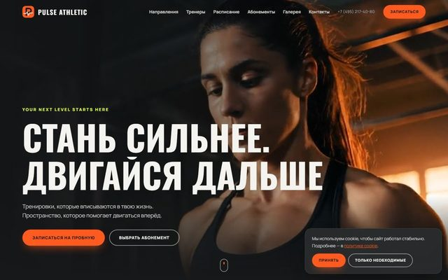
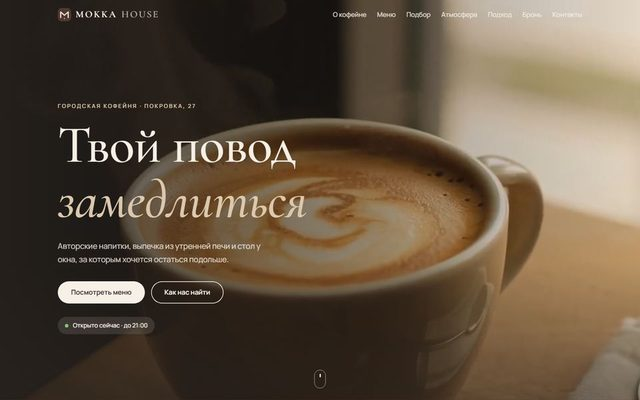
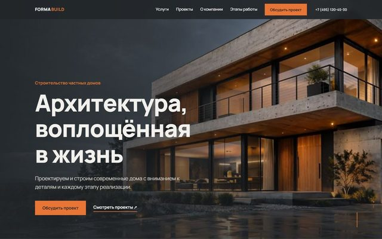
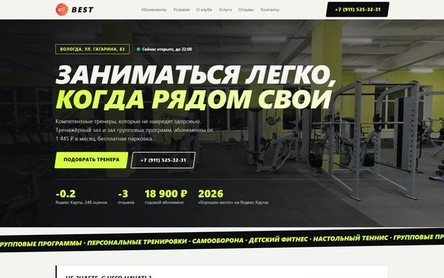
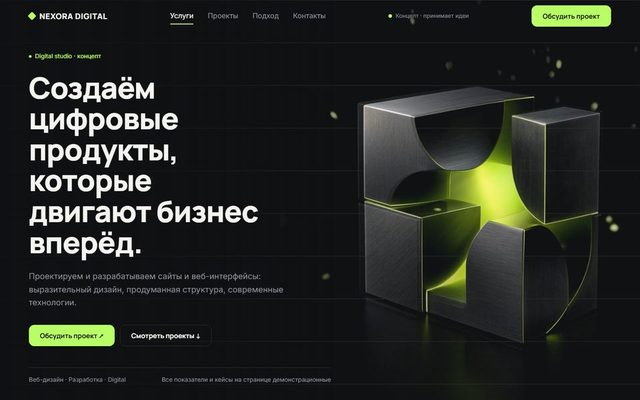

<h2>Разработка и дизайн веб-сайтов</h2>

Лендинги, интернет-магазины и сайты под ключ. 
От проектирования и дизайна до запуска и сопровождения.

 

 

<a href="#о-студии">О студии</a> &nbsp;·&nbsp; <a href="#услуги">Услуги</a> &nbsp;·&nbsp; <a href="#портфолио">Портфолио</a> &nbsp;·&nbsp; <a href="#технологии">Технологии</a> &nbsp;·&nbsp; <a href="#принципы-разработки">Принципы</a> &nbsp;·&nbsp; <a href="#порядок-работы">Порядок работы</a> &nbsp;·&nbsp; <a href="#контакты">Контакты</a>

---

## О студии

**SetchatkaGlaza** — студия веб-разработки и дизайна. Её основатель и единственный исполнитель — Валерий Корепин. Я веду проект на всех этапах: анализ задачи, проектирование, дизайн, разработка, запуск и дальнейшая поддержка.

Заказчик взаимодействует напрямую с исполнителем. Это сокращает время согласований, исключает потерю информации и делает ответственность за результат однозначной.

Задача каждого проекта — решать конкретную деловую цель: привлекать обращения, продавать товары и услуги, представлять компанию. Дизайн и код подчинены этой цели.

| | |
|---|---|
| **Направление** | Разработка и дизайн веб-сайтов |
| **Типы проектов** | Лендинги, интернет-магазины, корпоративные сайты и сайты-визитки |
| **Формат работы** | Индивидуально, прямое взаимодействие с исполнителем |
| **Языки сайтов** | Русский, английский |
| **Сопровождение** | Правки, обновления и развитие сайта после запуска |
| **Связь** | Telegram, ВКонтакте, электронная почта |

## Услуги

| Услуга | Назначение | Что входит |
|---|---|---|
| **Лендинги** | Привлечение обращений на одну услугу или продукт | Структура и тексты под предложение Анимации и адаптивная вёрстка Форма или кнопки связи |
| **Интернет-магазины** | Онлайн-продажи | Каталог, фильтры, карточки товаров Корзина и оформление заказа Оплата и доставка по схеме заказчика |
| **Сайты под ключ** | Представление компании в сети | Проработка структуры и дизайна Разработка и наполнение Публикация на домене и хостинге |
| **Дизайн** | Визуальный стиль и интерфейсы | Макеты страниц и интерфейсов Типографика, цвета, иконки Анимации и интерактив |
| **SEO** | Видимость сайта в поиске | Структура, заголовки, мета-теги Скорость загрузки и чистая вёрстка Микроразметка и карта сайта |
| **Поддержка** | Развитие сайта после запуска | Правки и обновление контента Исправление ошибок Новые разделы и функции |

## Портфолио

Ниже представлены концептуальные проекты, на которых отрабатываются дизайн, вёрстка и интерактив. У каждого есть рабочая демонстрационная версия и открытый исходный код. Превью ведут на живые сайты.

<table>
<tr><td align="center" width="25%"> <b>Pulse Athletic</b> Фитнес-клуб <a href="https://setchatkaglaza.github.io/pulse-athletic/">сайт</a> · <a href="https://github.com/SetchatkaGlaza/pulse-athletic">код</a></td><td align="center" width="25%"> <b>MOKKA HOUSE</b> Кофейня <a href="https://setchatkaglaza.github.io/mokka-house/">сайт</a> · <a href="https://github.com/SetchatkaGlaza/mokka-house">код</a></td><td align="center" width="25%"> <b>ÉLAN Skin</b> Бренд косметики <a href="https://setchatkaglaza.github.io/elan-skin/">сайт</a> · <a href="https://github.com/SetchatkaGlaza/elan-skin">код</a></td><td align="center" width="25%"> <b>FORMA BUILD</b> Строительная компания <a href="https://setchatkaglaza.github.io/Forma-Build/">сайт</a> · <a href="https://github.com/SetchatkaGlaza/Forma-Build">код</a></td></tr>
<tr><td align="center" width="25%"> <b>BEST Gym</b> Фитнес-клуб <a href="https://setchatkaglaza.github.io/best-site-gym/">сайт</a> · <a href="https://github.com/SetchatkaGlaza/best-site-gym">код</a></td><td align="center" width="25%"> <b>Перевозка леса</b> Транспортная компания <a href="https://setchatkaglaza.github.io/les-trans-website/">сайт</a> · <a href="https://github.com/SetchatkaGlaza/les-trans-website">код</a></td><td align="center" width="25%"> <b>Nexora Digital</b> Digital-студия <a href="https://setchatkaglaza.github.io/nexora-digital-landing/">сайт</a> · <a href="https://github.com/SetchatkaGlaza/nexora-digital-landing">код</a></td><td align="center" width="25%"><a href="https://github.com/SetchatkaGlaza?tab=repositories"><b>Все проекты на GitHub</b></a> полный список репозиториев</td></tr>
</table>

### Подробнее о проектах

| Проект | Сфера | Что реализовано | Технологии |
|---|---|---|---|
| [Pulse Athletic](https://setchatkaglaza.github.io/pulse-athletic/) | Фитнес-клуб | Многостраничный сайт: расписание с записью, тарифы с выбором срока, тренеры, галерея, подбор формата, юридические страницы | Vite, JavaScript |
| [MOKKA HOUSE](https://setchatkaglaza.github.io/mokka-house/) | Кофейня | Видео на первом экране, интерактивное меню, подбор напитка, бронирование стола, галерея с лайтбоксом, анимации | HTML, CSS, JavaScript |
| [ÉLAN Skin](https://setchatkaglaza.github.io/elan-skin/) | Бренд косметики | Лендинг премиального бренда: editorial-дизайн, демонстрационная корзина, адаптивная вёрстка | Vite, HTML, CSS, JavaScript |
| [FORMA BUILD](https://setchatkaglaza.github.io/Forma-Build/) | Строительная компания | Архитектурные проекты, каталог услуг, интерактивный калькулятор стоимости, анимации | HTML, CSS, JavaScript |
| [BEST Gym](https://setchatkaglaza.github.io/best-site-gym/) | Фитнес-клуб | Тарифы с фильтром, подбор абонемента, индикатор «открыто / закрыто» по графику работы, галерея, отзывы | HTML, CSS, JavaScript |
| [Перевозка леса](https://setchatkaglaza.github.io/les-trans-website/) | Транспортная компания | Адаптивный сайт компании по перевозке леса | HTML, CSS, JavaScript |
| [Nexora Digital](https://setchatkaglaza.github.io/nexora-digital-landing/) | Digital-студия | 12 секций, кейсы с галереей, FAQ, форма с валидацией, видеофон, доступность и поддержка prefers-reduced-motion | Vite, ES-модули |

## Технологии

| Область | Инструменты |
|---|---|
| **Клиентская часть** |     |
| **Серверная часть и данные** |     |
| **Другие языки** |   |
| **Инструменты и публикация** |    |

Там, где фреймворк не даёт преимуществ, я использую чистые HTML, CSS и JavaScript без лишних зависимостей. Это ускоряет загрузку, упрощает сопровождение и снижает стоимость владения сайтом.

## Принципы разработки

- **Адаптивность.** Каждый сайт корректно работает на телефоне, планшете и настольном компьютере.
- **Производительность.** Минимум зависимостей, оптимизированные изображения, быстрая загрузка.
- **Доступность.** Семантическая разметка, видимый фокус при работе с клавиатурой, учёт настройки пониженной анимации.
- **Основа для поиска.** Корректная структура заголовков, мета-теги, карта сайта и файл robots.txt.
- **Поддерживаемый код.** Понятная структура файлов и документация, чтобы сайт можно было развивать дальше.
- **Прозрачность.** Промежуточные результаты показываются на каждом этапе, решения согласуются до реализации.

## Порядок работы

| Этап | Что происходит | Результат |
|---|---|---|
| **1. Обсуждение** | Заказчик описывает задачу, исполнитель предлагает решение, сроки и стоимость | Согласованное техническое решение |
| **2. Дизайн** | Подготовка концепции и макетов, согласование до начала разработки | Утверждённый дизайн |
| **3. Разработка** | Вёрстка и программирование, демонстрация промежуточных результатов | Рабочая версия для проверки |
| **4. Запуск** | Публикация сайта, настройка домена и хостинга, передача материалов | Опубликованный сайт и дальнейшая поддержка |

## Как оформить заказ

Напишите в [Telegram](https://t.me/setchatka_glaza) или на [почту](mailto:Korepin.eil@yandex.ru) и кратко опишите задачу. Для быстрой и точной оценки укажите:

- чем занимается компания или проект и кто ваша аудитория;
- какой результат должен дать сайт: заявки, продажи, представление компании;
- какие разделы и функции нужны;
- примеры сайтов, которые вам нравятся;
- желаемые сроки.

В ответ вы получите предложение с описанием решения, сроками и стоимостью.

## Контакты

| Канал | Адрес |
|---|---|
| **Telegram** | [@setchatka_glaza](https://t.me/setchatka_glaza) |
| **ВКонтакте** | [vk.ru/setchatka_glaza](https://vk.ru/setchatka_glaza) |
| **Электронная почта** | [Korepin.eil@yandex.ru](mailto:Korepin.eil@yandex.ru) |
| **Сайт студии** | [setchatkaglaza.github.io](https://setchatkaglaza.github.io/) |
| **GitHub** | [github.com/SetchatkaGlaza](https://github.com/SetchatkaGlaza) |

 

© 2026 SetchatkaGlaza Web Studio. Валерий Корепин.

<<<<<<< HEAD

## Видео в главном блоке

Фон героя: `assets/video/` (`hero.webm`/`hero.mp4` для ПК, `hero-m.webm`/`hero-m.mp4` для телефонов в портрете, постеры `hero-poster*.jpg`).
Петля бесшовная (конец плавно перетекает в начало прямо в файле). Видео без звука, ставится на паузу вне экрана,
не запускается при `prefers-reduced-motion` (остаётся постер). Логика в `js/main.js` (блок «Hero video»), стили в конце `css/style.css`.
=======
>>>>>>> c43ae845f0d0d04d30a11b85e330ae70567d81d2
