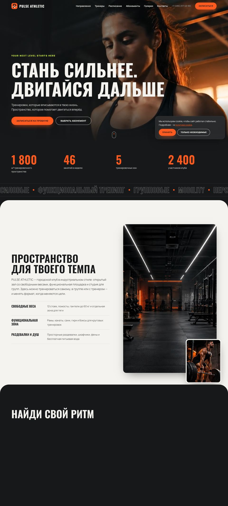
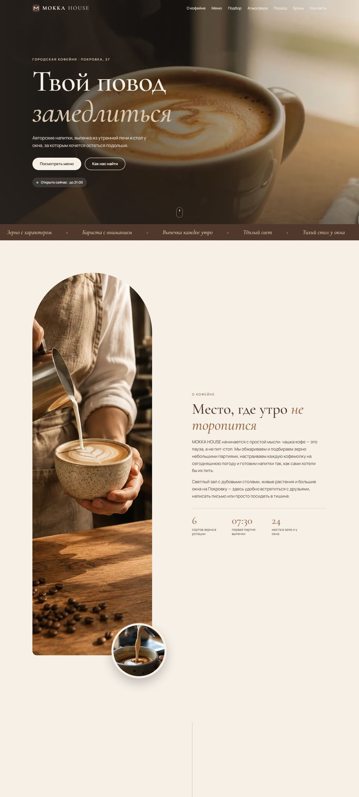
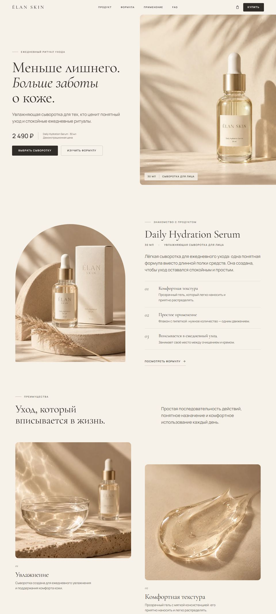
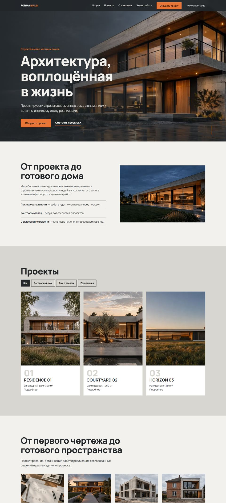
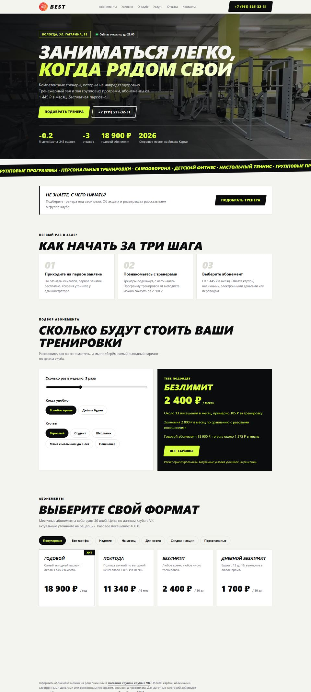
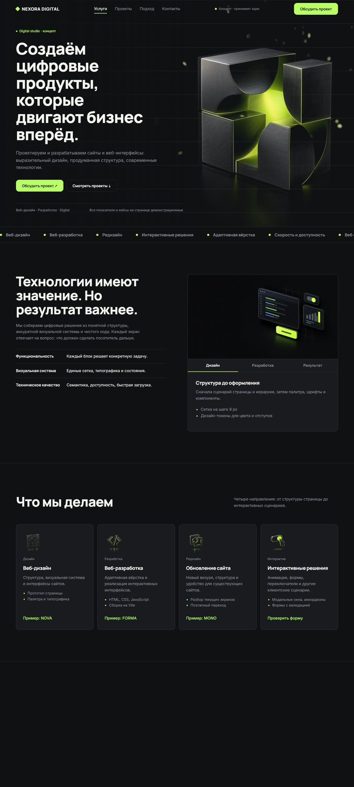

<div align="center">


### Сайты, на которые приятно смотреть и с которых приходят заявки

Сайт-визитка веб-студии **SetchatkaGlaza**: услуги, портфолио и контакты в одной странице.
Двуязычная (RU / EN), без сборки и фреймворков, на чистых HTML, CSS и JavaScript.

[](https://setchatkaglaza.github.io/)
[](LICENSE)


[Telegram](https://t.me/setchatka_glaza) · [ВКонтакте](https://vk.ru/setchatka_glaza) · [Email](mailto:Korepin.eil@yandex.ru) · [GitHub](https://github.com/SetchatkaGlaza)

</div>

---

## О проекте

Страница рассказывает, кто я, что делаю и как со мной связаться. Первый экран держится на нарисованном вручную силуэте замка в стилистике классического аниме: плоские грани света, густая чернота, зерно. Поверх него живёт фон из звёзд, которые тянутся к курсору.

## Возможности

- **Анимации без тормозов.** Один общий цикл `requestAnimationFrame`, плавное сглаживание курсора, все изменения DOM собраны в одном месте.
- **Замок-фон** остаётся на месте при прокрутке, слегка смещается за курсором и мягко растворяется по мере скролла.
- **Портфолио в рамках ноутбука и телефона.** Страница проекта сама прокручивается при наведении или когда блок в центре экрана.
- **Услуги** в виде интерактивных вкладок с подробным описанием, управление мышью и стрелками.
- **RU / EN** с запоминанием выбора.
- **Адаптивность и доступность:** видимый фокус, `prefers-reduced-motion`, семантическая разметка.
- **SEO и PWA-мелочи:** Open Graph, `robots.txt`, `sitemap.xml`, `favicon.ico`, SVG, Apple Touch, `site.webmanifest`, страница 404.

## Портфолио

<table>
<tr>
<td align="center"><a href="https://setchatkaglaza.github.io/pulse-athletic/"></a><br><b>Pulse Athletic</b><br>фитнес-клуб</td>
<td align="center"><a href="https://setchatkaglaza.github.io/mokka-house/"></a><br><b>MOKKA HOUSE</b><br>кофейня</td>
<td align="center"><a href="https://setchatkaglaza.github.io/elan-skin/"></a><br><b>ÉLAN Skin</b><br>косметика</td>
</tr>
<tr>
<td align="center"><a href="https://setchatkaglaza.github.io/Forma-Build/"></a><br><b>FORMA BUILD</b><br>строительство</td>
<td align="center"><a href="https://setchatkaglaza.github.io/best-site-gym/"></a><br><b>BEST Gym</b><br>фитнес-клуб</td>
<td align="center"><a href="https://setchatkaglaza.github.io/nexora-digital-landing/"></a><br><b>Nexora Digital</b><br>digital-студия</td>
</tr>
</table>

## Структура

```text
.
├── index.html               страница (RU / EN в одном файле)
├── 404.html                 страница «не найдено»
├── css/style.css            стили и дизайн-токены (:root)
├── js/main.js               фон, анимации, вкладки, переключатель языка
├── assets/
│   ├── logo.png             логотип
│   ├── favicon.ico / .svg   иконки сайта
│   ├── apple-touch-icon.png, icon-192.png, icon-512.png
│   ├── og-image.png         превью для соцсетей
│   └── shots/               скриншоты проектов (десктоп и мобильная версия)
├── scripts/screenshots.mjs  обновление скриншотов через Playwright
├── .github/workflows/       автодеплой на GitHub Pages
├── site.webmanifest, robots.txt, sitemap.xml
└── LICENSE, package.json, .editorconfig, .gitignore
```

## Быстрый старт

```bash
git clone https://github.com/SetchatkaGlaza/setchatkaglaza.github.io.git
cd setchatkaglaza.github.io
npm start            # локальный сервер, либо откройте index.html любым статическим сервером
```

## Публикация

1. Репозиторий должен называться `setchatkaglaza.github.io`.
2. **Settings → Pages → Source: GitHub Actions.**
3. Каждый push в `main` запускает деплой через `.github/workflows/pages.yml`.

Другое имя репозитория? Поправьте адрес в `og:image` (`index.html`), `robots.txt` и `sitemap.xml`.

## Обновление скриншотов

```bash
npm install
npx playwright install chromium
npm run shots
```

## Настройка

| Что менять | Где |
|---|---|
| Цвета и шрифты | переменные `:root` в `css/style.css` |
| Тексты и контакты | `index.html`, у каждого текста есть версии `.ru` и `.en` |
| Новый проект | скопируйте блок `<article class="cs">` и добавьте имя в `scripts/screenshots.mjs` |

## Контакты

**Валерий Корепин** · SetchatkaGlaza Web Studio
Telegram [@setchatka_glaza](https://t.me/setchatka_glaza) · [ВКонтакте](https://vk.ru/setchatka_glaza) · [Korepin.eil@yandex.ru](mailto:Korepin.eil@yandex.ru)

## English

A bilingual (RU / EN) business-card website for the SetchatkaGlaza web studio, built with plain HTML, CSS and JavaScript, no build step. It features a hand-drawn cel-shaded castle background, an interactive starfield, device-framed portfolio previews and tabbed services. Deploys to GitHub Pages via the included workflow.

## Лицензия

[MIT](LICENSE) © 2026 Valerii Korepin
# setchatkaglaza
